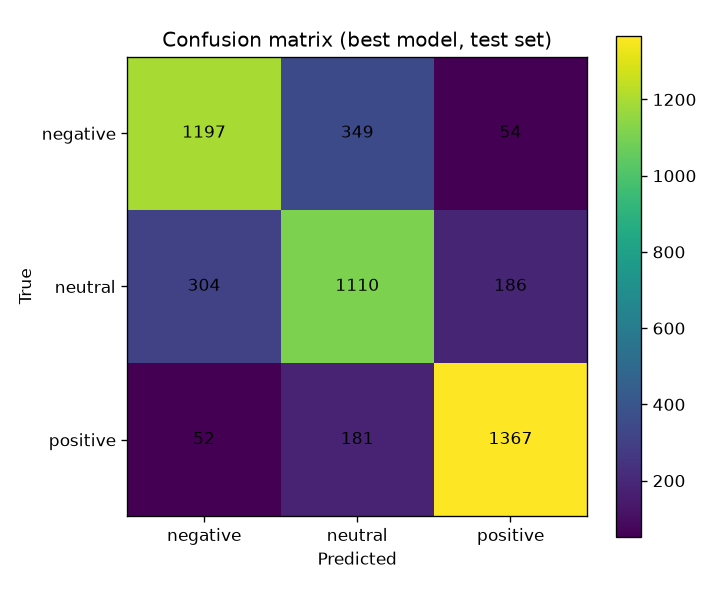

# Evaluation Report: Customer Review Sentiment Analyzer

## Approach

1. **Data** — Streamed the public `McAuley-Lab/Amazon-Reviews-2023`
   (`raw/review_categories/All_Beauty.jsonl`) and kept a class-balanced
   sample: 8,000 reviews each of negative (1–2 stars), neutral (3 stars)
   and positive (4–5 stars) → 24,000 rows in `data/reviews.csv`.
2. **Preprocessing** — `src/preprocess.py`: HTML-unescape, strip tags/URLs,
   lowercase, drop non-text characters, collapse whitespace; title and body
   combined, capped at 2,000 characters.
3. **Split** — stratified 80/20 train/test split (`random_state=42`).
4. **Models** — TF-IDF (20k features, 1–2 grams, sublinear TF) feeding two
   classifiers: Multinomial Naive Bayes and Logistic Regression.
5. **Selection** — compared on the held-out test set; winner = highest
   macro F1. Saved as `models/best_model.joblib` with `metrics.json` and a
   confusion-matrix plot.
6. **Serving** — FastAPI (`/health`, `/info`, `/predict`, `/predict/batch`)
   plus a `python -m src.predict` CLI.

## Key decisions

- **Real product reviews, balanced classes.** Raw Amazon ratings skew
  heavily to 5 stars, so the sampler streams the dump and keeps equal
  numbers per class — otherwise accuracy would hide poor minority-class
  performance.
- **Two linear models, not deep learning.** Naive Bayes vs Logistic
  Regression is an honest, fast, explainable baseline pair; both train in
  seconds on CPU and serialize to a 1.2 MB file.
- **Macro F1 as the selection metric**, so the hard "neutral" class counts
  equally instead of being drowned out by easy positives.
- **Probabilities in the API**, so callers get a confidence score, not just
  a label.

## Results (test set, n = 4,800)

| Model               | Accuracy | Macro Precision | Macro Recall | Macro F1 |
| ------------------- | -------- | --------------- | ------------ | -------- |
| Naive Bayes         | 0.7538   | 0.7573          | 0.7538       | 0.7547   |
| Logistic Regression | **0.7654** | **0.7661**    | **0.7654**   | **0.7657** |

Best model per-class scores:

| Class    | Precision | Recall | F1     | Support |
| -------- | --------- | ------ | ------ | ------- |
| negative | 0.7708    | 0.7481 | 0.7593 | 1,600   |
| neutral  | 0.6768    | 0.6937 | 0.6852 | 1,600   |
| positive | 0.8507    | 0.8544 | 0.8525 | 1,600   |

Confusion matrix (rows = true, columns = predicted: negative / neutral / positive):

|               | pred neg | pred neu | pred pos |
| ------------- | -------- | -------- | -------- |
| true negative | 1,197    | 349      | 54       |
| true neutral  | 304      | 1,110    | 186      |
| true positive | 52       | 181      | 1,367    |

*Neutral* reviews are the hardest: 3-star texts mix praise and complaint
("good but..."), which a bag-of-words model often misreads. Positive reviews
are the easiest (F1 0.85) — enthusiastic language is distinctive.

## Challenges

- The HuggingFace `datasets` library no longer supports the dataset's
  legacy loading script, so the downloader streams the raw `.jsonl` over
  HTTP instead — simpler and dependency-free.
- Collecting 8,000 negative reviews required scanning ~89k rows because
  most Amazon ratings are 4–5 stars; the streaming sampler stops as soon as
  every class bucket is full.

## Improvements

- Try a transformer-based classifier (e.g. DistilBERT fine-tune) to capture
  word order, negation and sarcasm — likely the biggest gain for the neutral
  class.
- Add a validation split and grid-search `C` / n-gram range instead of
  fixed hyperparameters.
- Expand beyond the Beauty category and add multilingual reviews.
- Add request logging and a simple HTML demo page on top of the API.
